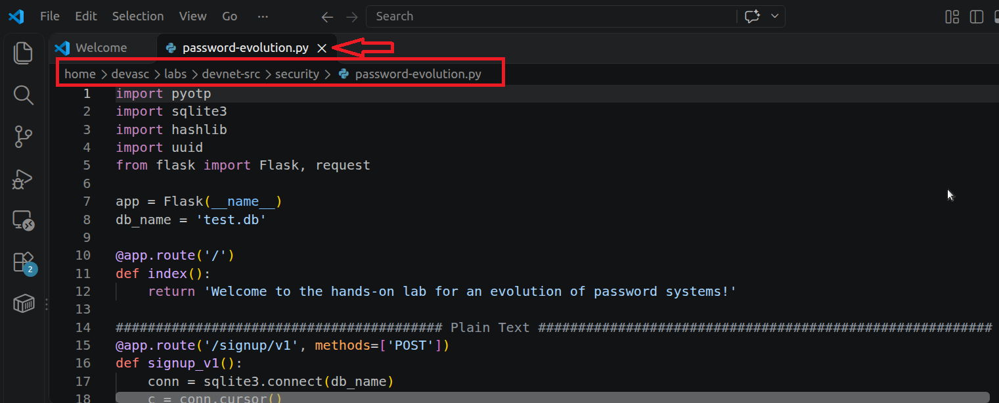
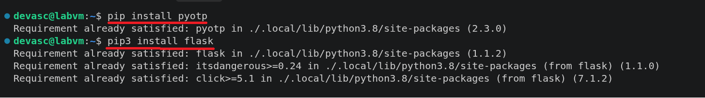
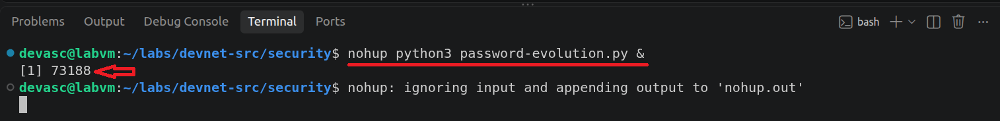
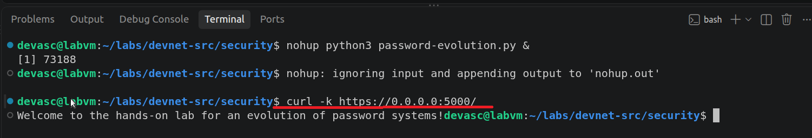
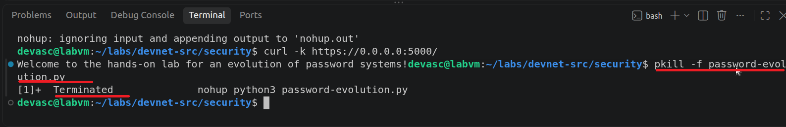
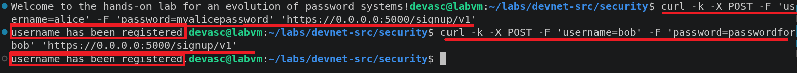
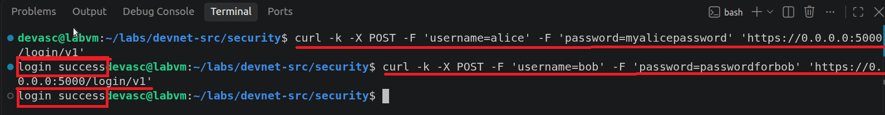
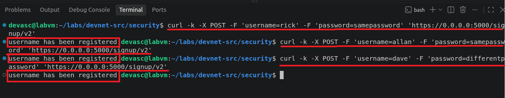
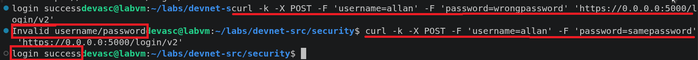

# TECHNICAL LOG & EXPLORE THE EVOLUTION OF PASSWORD METHODS

## DEVASC
**CCNP Miguelangel Luna**

---

## CONTENIDOS:

| Case | Title | Description |
| :--- | :--- | :--- |
| **01** | [Claude & n8n AI Agents](./case-01-Google-Auth/) | Agentes Claude . |


[Google](https://www.google.com)

## 1. Introduction and Theoretical Framework

**A library:** is a collection of reusable code — functions, classes, modules — that someone else has already written and packaged so that you can use it in your own programs without having to reinvent it. A library can be a small piece of reusable code, like a function called **sumar.py that takes two variables (A and B) and returns a result (C) using the formula A + B = C**. You don't need to know how it works internally; you just call it and use the result

Example. the library **sumar.py** :

```text
def sumar(a, b):
    return a + b
```

In the following example we are calling the library function **sumar**, giving it the values **2 and 3**, storing the returned result in c, and then printing it with print(c). That's exactly how using a library works main.py

```text
from my_library import sumar

c = sumar(2, 3)
print(c)  # Output: 5
```

**framework: ** is a pre-built skeleton on which you build your application: it defines the structure and the flow, and you just fill in the gaps with your code.

**Framework example:** The blueprint of a house: the structure (foundation, beams, rooms) is already decided. You just furnish and decorate each space.

## 2. INFO


## Part 3: Install Packages and Create a Web Service:

**3.1)** In your DEVASC VM, open VS Code, go to File > Open Folder... and select the **labs/devnet-src/security folder.**

Open the **password-evolution.py** file.




**3.2)** Open a terminal in VS Code (Terminal > New Terminal) and run the installation of the necessary packages.

**What is PyOTP?** 

PyOTP is a **Python library** for generating and verifying time-based one-time passwords (TOTP) and counter-based one-time passwords (HOTP). It is mainly used to implement **two-factor authentication (2FA)**.

**What is Flask?**

Flask is a **micro web framework for Python**. It is used to build web applications and APIs in a lightweight and flexible way. It is called "micro" because it includes only the essentials and lets you add the rest as needed (unlike heavier frameworks such as Django).

**What is it used for?**
With Flask you can:

Create websites and REST APIs.

Define routes (URLs) and associate them with Python functions.

Handle HTTP requests (GET, POST, etc.) and return responses.

Render HTML templates (with Jinja2).

Manage sessions, cookies, and forms.

Serve static files (CSS, JS, images).

**PYOTP and FLASK installation:**

```text
pip3 install pyotp
pip3 install flask
```



**3.3)** Basic Web Server with HTTPS (self-signed certificate):

Here is the code for the **password-evolution.py** file. This server starts a local web server with HTTPS using a self-signed certificate.

```text
import pyotp
import sqlite3
import hashlib
import uuid
from flask import Flask, request

app = Flask(__name__)
db_name = 'test.db'

@app.route('/')
def index():
    return 'Welcome to the hands-on lab for an evolution of password systems!'

if __name__ == '__main__':
    app.run(host='0.0.0.0', port=5000, ssl_context='adhoc')
```

**3.4)** Save the file (Ctrl + S) and run it in the background, execute the following command **(nohup python3 password-evolution.py)**:

**nohup** → "no hang up" (don't hang up)
Normally, when you close the terminal or the SSH session is cut off, the system sends a SIGHUP (hang up) signal to the child processes and kills them.

**python** — Invokes the Python interpreter.

**password-evolution.py** — The script file you want to execute.

**&** — Runs the process in the background, so the terminal returns control to you immediately instead of waiting for the script to finish.

```text
nohup  python3 password-evolution.py  &
  │              │                    │
  │              │                    └── ejecuta en segundo plano
  │              └── ejecuta el script con Python 3
  └── "no hang up": inmune a la desconexión
```

```text
nohup python3 password-evolution.py
```



**3.5)** Verify that it responds using **curl**:

```text
curl -k https://0.0.0.0:5000/
```



**3.6)** Stop the server before moving on to the next part:

```text
pkill -f password-evolution.py
```


## Part 4:Complete Code (Plain Text + SHA-256 Hashing):

**4.1)** Instead of deleting and re-adding the if __name__ == '__main__': block twice as the guide asks, here is the complete and functional code for Part 6 (which includes both the v1 plain-text version and the v2 SHA-256 hash version).

Replace the entire contents of password-evolution.py with this and save (Ctrl + S):


```text
import pyotp
import sqlite3
import hashlib
import uuid
from flask import Flask, request

app = Flask(__name__)
db_name = 'test.db'

@app.route('/')
def index():
    return 'Welcome to the hands-on lab for an evolution of password systems!'

######################################### Plain Text #########################################################
@app.route('/signup/v1', methods=['POST'])
def signup_v1():
    conn = sqlite3.connect(db_name)
    c = conn.cursor()
    c.execute('''CREATE TABLE IF NOT EXISTS USER_PLAIN
           (USERNAME  TEXT    PRIMARY KEY NOT NULL,
            PASSWORD  TEXT    NOT NULL);''')
    conn.commit()
    try:
        c.execute("INSERT INTO USER_PLAIN (USERNAME,PASSWORD) "
                  "VALUES ('{0}', '{1}')".format(request.form['username'], request.form['password']))
        conn.commit()
    except sqlite3.IntegrityError:
        return "username has been registered."
    print('username: ', request.form['username'], ' password: ', request.form['password'])
    return "signup success"

def verify_plain(username, password):
    conn = sqlite3.connect('test.db')
    c = conn.cursor()
    query = "SELECT PASSWORD FROM USER_PLAIN WHERE USERNAME = '{0}'".format(username)
    c.execute(query)
    records = c.fetchone()
    conn.close()
    if not records:
        return False
    return records[0] == password

@app.route('/login/v1', methods=['GET', 'POST'])
def login_v1():
    error = None
    if request.method == 'POST':
        if verify_plain(request.form['username'], request.form['password']):
            error = 'login success'
        else:
            error = 'Invalid username/password'
    else:
        error = 'Invalid Method'
    return error

######################################### Password Hashing #########################################################
@app.route('/signup/v2', methods=['GET', 'POST'])
def signup_v2():
    conn = sqlite3.connect(db_name)
    c = conn.cursor()
    c.execute('''CREATE TABLE IF NOT EXISTS USER_HASH
           (USERNAME  TEXT    PRIMARY KEY NOT NULL,
            HASH      TEXT    NOT NULL);''')
    conn.commit()
    try:
        hash_value = hashlib.sha256(request.form['password'].encode()).hexdigest()
        c.execute("INSERT INTO USER_HASH (USERNAME, HASH) "
                  "VALUES ('{0}', '{1}')".format(request.form['username'], hash_value))
        conn.commit()
    except sqlite3.IntegrityError:
        return "username has been registered."
    print('username: ', request.form['username'], ' password: ', request.form['password'], ' hash: ', hash_value)
    return "signup success"

def verify_hash(username, password):
    conn = sqlite3.connect(db_name)
    c = conn.cursor()
    query = "SELECT HASH FROM USER_HASH WHERE USERNAME = '{0}'".format(username)
    c.execute(query)
    records = c.fetchone()
    conn.close()
    if not records:
        return False
    return records[0] == hashlib.sha256(password.encode()).hexdigest()

@app.route('/login/v2', methods=['GET', 'POST'])
def login_v2():
    error = None
    if request.method == 'POST':
        if verify_hash(request.form['username'], request.form['password']):
            error = 'login success'
        else:
            error = 'Invalid username/password'
    else:
        error = 'Invalid Method'
    return error

if __name__ == '__main__':
    app.run(host='0.0.0.0', port=5000, ssl_context='adhoc')
```

**4.2)** execute the following command **(nohup python3 password-evolution.py)**:

**nohup** → "no hang up" (don't hang up)
Normally, when you close the terminal or the SSH session is cut off, the system sends a SIGHUP (hang up) signal to the child processes and kills them.

**python** — Invokes the Python interpreter.

**password-evolution.py** — The script file you want to execute.

**&** — Runs the process in the background, so the terminal returns control to you immediately instead of waiting for the script to finish.

```text
nohup  python3 password-evolution.py  &
  │              │                    │
  │              │                    └── ejecuta en segundo plano
  │              └── ejecuta el script con Python 3
  └── "no hang up": inmune a la desconexión
```

```text
nohup python3 password-evolution.py
```


**4.3)** The following commands are used to simulate user data entry (registration of new users), in this case 2 users, alice and bob, through the following commands:

```text
curl -k -X POST -F 'username=alice' -F 'password=myalicepassword' 'https://0.0.0.0:5000/signup/v1'
```
```text
curl -k -X POST -F 'username=bob' -F 'password=passwordforbob' 'https://0.0.0.0:5000/signup/v1'
```



**4.4)** Test login, using the credentials created before:

```text
curl -k -X POST -F 'username=alice' -F 'password=myalicepassword' 'https://0.0.0.0:5000/login/v1'
```
```text
curl -k -X POST -F 'username=bob' -F 'password=passwordforbob' 'https://0.0.0.0:5000/login/v1'
```



**5.1)** The following commands are used to simulate user data entry (registration of new users), in this case 3 users, rick, allan and dave, through the following commands:

```text
curl -k -X POST -F 'username=rick' -F 'password=samepassword' 'https://0.0.0.0:5000/signup/v2'
```
```text
curl -k -X POST -F 'username=allan' -F 'password=samepassword' 'https://0.0.0.0:5000/signup/v2'
```
```text
curl -k -X POST -F 'username=dave' -F 'password=differentpassword' 'https://0.0.0.0:5000/signup/v2'
```



**5.2)** Test login (including an intentional failure with allan):

```text
curl -k -X POST -F 'username=rick' -F 'password=samepassword' 'https://0.0.0.0:5000/login/v2'
```
Using a wrong password:

```text
curl -k -X POST -F 'username=allan' -F 'password=wrongpassword' 'https://0.0.0.0:5000/login/v2'
curl -k -X POST -F 'username=allan' -F 'password=samepassword' 'https://0.0.0.0:5000/login/v2'
```


```text
curl -k -X POST -F 'username=dave' -F 'password=differentpassword' 'https://0.0.0.0:5000/login/v2'
```


### 4. BGP Configuration:

