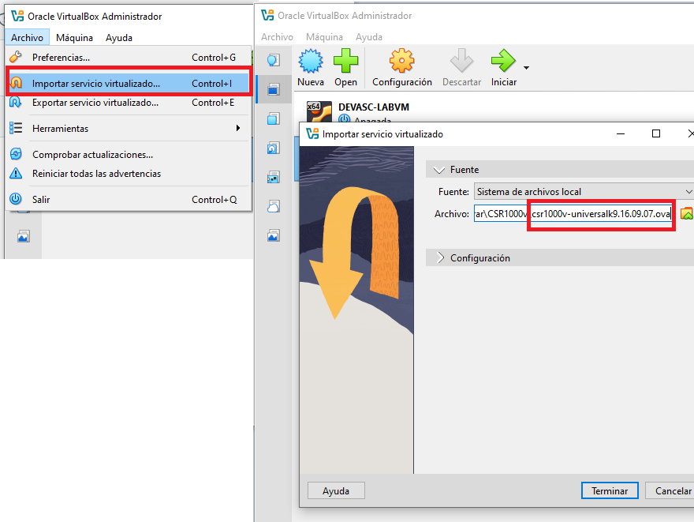
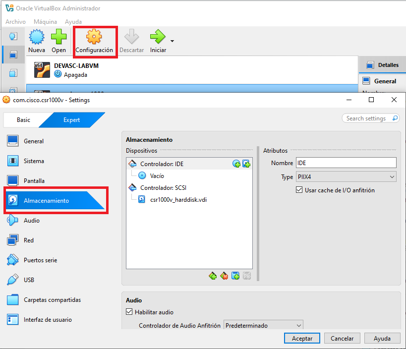
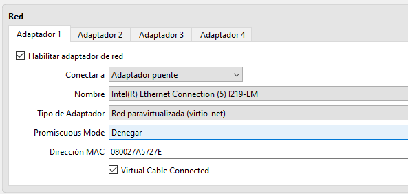

# Technical Documentation: Install the Cloud Services Router 1000V (CSR1000v) VM on Virtualbox

## Cloud Services Router 1000V (CSR1000v)

**CCNP Miguelangel Luna**

---

[Download from Cisco Software Central](https://software.cisco.com/)

[OVA Download](https://ftp.radio-portal.su/index.php?folder=Cisco%2FVirtual%2FCSR1000v)

## 1. Introduction and Theoretical Framework

This is a **Cisco software virtual** router deployed on a virtual machine (VM) instance on x86 server hardware. When the Cisco CSR 1000v is deployed on a VM, the Cisco IOS XE software functions as if it were deployed on a traditional Cisco hardware platform. You can configure different features depending on the Cisco IOS XE software image. We will install the 

# Objectives 
Part 1: Install the CSR1000v VM on VirtualBox 

Part 2: Verify Communications to CSR1000v VM 

### Proxmox Backup Server (PBS):

## 2. Prerequisites


- Host computer with at least 4 GB of RAM and 2 GB of free disk space 
- Virtual Box or VMware 
- DEVASC Virtual Machine
- [csr1000v-universalk9.16.09.07.ova](https://ftp.radio-portal.su/index.php?folder=Cisco%2FVirtual%2FCSR1000v) 


We need the following images:


## 3. Implementation and Deployment Steps

**3.1)** Import the CSR1000v VM **(csr1000v-universalk9.16.09.07.ova).** esta es la plantilla de la VM.

a. Open Oracle VirtualBox Manager. 

b. Select File > Import in VirtualBox or File > Open in VMware. In VMware Workstation Player, select Player > File > Open. 

c. In VirtualBox, select the file **`csr1000v-universalk9.16.09.07.ova`** and click Open and Import. 

In VMware, select the file **`csr1000v-universalk9.16.09.07.ova`** and click Open. 

d. Click Import. 

e. You will now see the CSR1000v VM added to VirtualBox or VMware. 




**3.2)** Import the CSR1000v VM **(`csr1000v-universalk9.16.09.05.iso`)** esta es el IOS del Cisco.

Update the installation ISO location.**

a. Select the Virtual Machine Settings or click Edit virtual machine settings. 

b. In the VM Settings, go to the very first CD Drive setting. 

- In VirtualBox: VM Settings > Storage > CD device (the first CD Drive in the list) 
- In VMware: VM Settings > the first "CD/DVD (IDE)" Drive in the list
  
c. In the first CD Drive settings, replace the currently used ISO file 
- In VirtualBox: Attributes > CD icon > Choose a disk file ... 
- In VMware: Next to "Use ISO image file", click Browse.
  
d. Select the ISO file you received from your instructor in Step 1. 
At the time this lab was written, the file name was **`csr1000v-universalk9.16.09.05.iso`**. 



c. Verify the following: 
Adapter 1 - Attached to: Host-only Adapter 
d. Click OK. 

```text
& "C:\Program Files\Oracle\VirtualBox\VBoxManage.exe" modifyvm "com.cisco.csr1000v" --nictype1 virtio
```




**3.3)** VM Loading Process.**

Start the VM. 

a. Within the VM window, press Enter. 
You should now see the prompt: `CSR1kv>`. 
b. Enter `enable` for the privileged EXEC prompt. There is no enable password. 

```text
CSR1kv> enable
CSR1kv#
```
