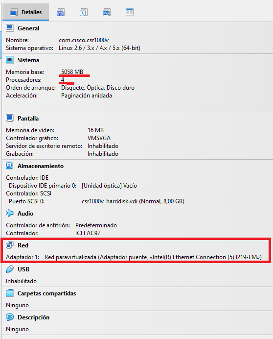

# Technical Documentation: Install the Cloud Services Router 1000V (CSR1000v) VM on Virtualbox

## Cloud Services Router 1000V (CSR1000v)

**CCNP Miguelangel Luna**

---

[OVA Download](https://ftp.radio-portal.su/index.php?folder=Cisco%2FVirtual%2FCSR1000v)

## 1. Introduction and Theoretical Framework

This is a **Cisco software virtual** router deployed on a virtual machine (VM) instance on x86 server hardware. When the Cisco CSR 1000v is deployed on a VM, the Cisco IOS XE software functions as if it were deployed on a traditional Cisco hardware platform. You can configure different features depending on the Cisco IOS XE software image. We will install the 

- Host computer with at least 4 GB of RAM and 2 GB of free disk space 
- Virtual Box or VMware 
- DEVASC Virtual Machine 

# Objectives 
Part 1: Install the CSR1000v VM on VirtualBox 

Part 2: Verify Communications to CSR1000v VM 

### Proxmox Backup Server (PBS):

## 2. Prerequisites




Before deploying and executing the script on any new Proxmox VE server, ensure the following requirements are met:
1. **Proxmox VE Connected to PBS:** The PVE node must have the Proxmox Backup Server storage added to its configuration.
2. **Dependency Installation (`jq`):** The JSON processor must be present on the base operating system.
3. **Proxmox API Token:** An authentication token with administrator privileges is required to interact with the local API without needing plain-text passwords.

## 3. Implementation and Deployment Steps
Follow these steps on any new Proxmox VE server to make the restoration script fully operational:

### Step 1: Install the `jq` Dependency
Run the following command in the terminal to install the JSON processor:

**JQ Tool (pve shell)**

```text
& "C:\Program Files\Oracle\VirtualBox\VBoxManage.exe" modifyvm "com.cisco.csr1000v" --nictype1 virtio
```

 
### 4. BGP Configuration:


# Lab - 

#
## Background / Scenario 
In this lab, you will install the . 
In this lab, you will install the . 
In this lab, you will install the . 

**Note:** The CSR1000v name will be shortened to CSR1kv in future labs. However, for this lab we use CSR1000v. 

## Required Resources 


## Instructions 

### Part 1: Install the CSR 1000v VM 
Install the CSR1000v VM directly on your x86 computer. It requires at least 4GB of RAM. 

**Step 1: Instructor only: Download the CSR1000v ISO file.** 
**Note:** Only the instructor or anyone with proper credentials is allowed to download ISO files from Cisco. This step must be done by the instructor. 

a. To download the CSR1000v ISO go to: [https://software.cisco.com/download/home/284364978/type/282046477/release/Fuji-16.9.5](https://software.cisco.com/download/home/284364978/type/282046477/release/Fuji-16.9.5) 

**Note:** To download software from cisco.com, you must be an active NetAcad instructor and have a CCO account with the activated NetAcad Maintenance contract. 

b. Select the download icon to the right of the following file: 
Cisco CSR1000V IOS XE Universal - CRYPTO ISO 
`csr1000v-universalk9.16.09.05.iso` 

c. The instructor may now distribute this ISO to students to use in the DevNet Associate course only. 

**Step 2: Download the CSR1000v VM OVA file.** 

a. Download the `DEVASC_CSR1000v.zip` from the course resources and note the location of file. 
b. This file contains both the VirtualBox and VMware template files. Unzip the file to access the VMs.

**Step 3: Install the CSR1000v VM.**
a. Open Oracle VirtualBox Manager or VMware Workstation. 
b. Select File > Import in VirtualBox or File > Open in VMware. In VMware Workstation Player, select Player > File > Open. 
c. In VirtualBox, select the file `CSR1000v_for_VirtualBox.ova` and click Open and Import. 
In VMware, select the file `CSR1000v_for_VMware.ova` and click Open. 
d. Click Import. 
e. You will now see the CSR1000v VM added to VirtualBox or VMware. 

**Step 4: Update the installation ISO location.**
a. Select the Virtual Machine Settings or click Edit virtual machine settings. 
b. In the VM Settings, go to the very first CD Drive setting. 
- In VirtualBox: VM Settings > Storage > CD device (the first CD Drive in the list) 
- In VMware: VM Settings > the first "CD/DVD (IDE)" Drive in the list 
c. In the first CD Drive settings, replace the currently used ISO file 
- In VirtualBox: Attributes > CD icon > Choose a disk file ... 
- In VMware: Next to "Use ISO image file", click Browse. 
d. Select the ISO file you received from your instructor in Step 1. 
At the time this lab was written, the file name was `csr1000v-universalk9.16.09.05.iso`. However, the version (16.09.05) may have changed, altering the file name. 
e. Do NOT change the Second CD Drive settings. That is used for the initial configuration of the router. 
f. Click OK to save the Virtual Machine settings. 

**Step 5: For VirtualBox on Mac and Linux, verify the CSR1000v is using a Host-Only Adapter.**
a. In VirtualBox, click File > Host Network Manager... 
b. Verify that there is a host adapter with a name such as `vxboxnet0` with an IPv4 Address/Mask `192.168.56.1/24`. It is important that your host-only adapter is on the `192.168.56.0/24` network. 
c. If host adapter does not exist, click Create. 
d. If the IPv4 address is not on `192.168.56.1/24`, select the adapter and click Properties. Modify the IPv4 address and click Close. 

**Step 6: Start CSR1000v VM.**
a. Select the CSR1000v VM and click Start or Power On. 
b. If you receive the following message, continue with this step, otherwise, go to the next step: 
> Could not start the machine DEVASC-CSR1000v because the following physical network interfaces were not found:
> VirtualBox Host-Only Ethernet Adapter (adapter 1)
> You can either change the machine's network settings or stop the machine.

c. Verify the following: 
Adapter 1 - Attached to: Host-only Adapter 
d. Click OK. 

**Step 7: VM Loading Process.**
During the loading process you will see several messages including a message to Press any key to continue. You can ignore all of these messages. 
A selection screen will appear where you can choose different configuration options. Do not choose any configuration options. Installation will continue on its own. 
Wait for the initial installation process to complete. This will take several minutes the first time you boot the CSR1000v. 
You will begin to see IOS messages from different processes including `%SSH`, `%PKI` and `%CRYPTO_ENGINE`. After a few minutes the messages will stop. 

a. Within the VM window, press Enter. 
You should now see the prompt: `CSR1kv>`. 
b. Enter `enable` for the privileged EXEC prompt. There is no enable password. 
```text
CSR1kv> enable
CSR1kv#
