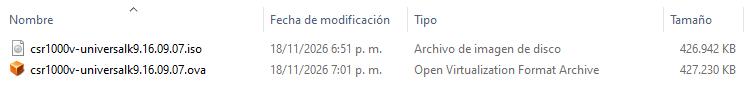

# Technical Documentation: Install the Cloud Services Router 1000V (CSR1000v) VM on Virtualbox

## Cloud Services Router 1000V (CSR1000v)

**CCNP Miguelangel Luna**

---

[Download from Cisco Software Central](https://software.cisco.com/)

[OVA Download](https://ftp.radio-portal.su/index.php?folder=Cisco%2FVirtual%2FCSR1000v)

## 1. Introduction and Theoretical Framework

This is a **Cisco software virtual** router deployed on a virtual machine (VM) instance on x86 server hardware. When the Cisco CSR 1000v is deployed on a VM, the Cisco IOS XE software functions as if it were deployed on a traditional Cisco hardware platform. You can configure different features depending on the Cisco IOS XE software image. We will install the 

# Objectives 
Part 1: Install the CSR1000v VM on VirtualBox 

Part 2: Verify Communications to CSR1000v VM 

### Proxmox Backup Server (PBS):

## 2. Prerequisites


- Host computer with at least 4 GB of RAM and 2 GB of free disk space 
- Virtual Box or VMware 
- DEVASC Virtual Machine
- [csr1000v-universalk9.16.09.07.ova](https://ftp.radio-portal.su/index.php?folder=Cisco%2FVirtual%2FCSR1000v) 


We need the following images:



## 3. Implementation and Deployment Steps

**3.1)** Import the CSR1000v VM.

```text
& "C:\Program Files\Oracle\VirtualBox\VBoxManage.exe" modifyvm "com.cisco.csr1000v" --nictype1 virtio
```

 
### 4. BGP Configuration:

## Required Resources 


## Instructions 

**Step 3: Import the CSR1000v VM.**

a. Open Oracle VirtualBox Manager or VMware Workstation. 
b. Select File > Import in VirtualBox or File > Open in VMware. In VMware Workstation Player, select Player > File > Open. 
c. In VirtualBox, select the file `CSR1000v_for_VirtualBox.ova` and click Open and Import. 
In VMware, select the file `CSR1000v_for_VMware.ova` and click Open. 
d. Click Import. 
e. You will now see the CSR1000v VM added to VirtualBox or VMware. 

**Step 6: Start CSR1000v VM.**


c. Verify the following: 
Adapter 1 - Attached to: Host-only Adapter 
d. Click OK. 

**Step 7: VM Loading Process.**
During the loading process you will see several messages including a message to Press any key to continue. You can ignore all of these messages. 
A selection screen will appear where you can choose different configuration options. Do not choose any configuration options. Installation will continue on its own. 
Wait for the initial installation process to complete. This will take several minutes the first time you boot the CSR1000v. 
You will begin to see IOS messages from different processes including `%SSH`, `%PKI` and `%CRYPTO_ENGINE`. After a few minutes the messages will stop. 

a. Within the VM window, press Enter. 
You should now see the prompt: `CSR1kv>`. 
b. Enter `enable` for the privileged EXEC prompt. There is no enable password. 
```text
CSR1kv> enable
CSR1kv#
