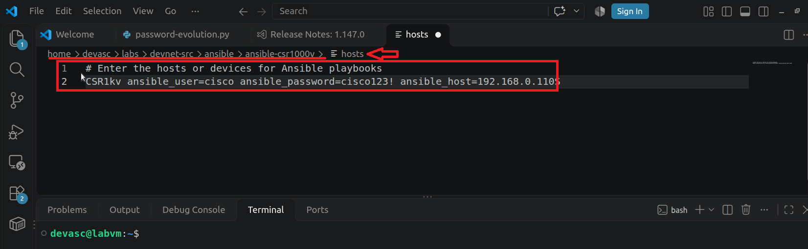
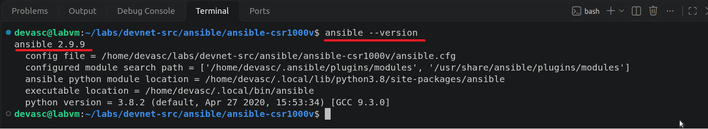
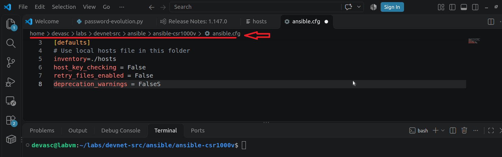
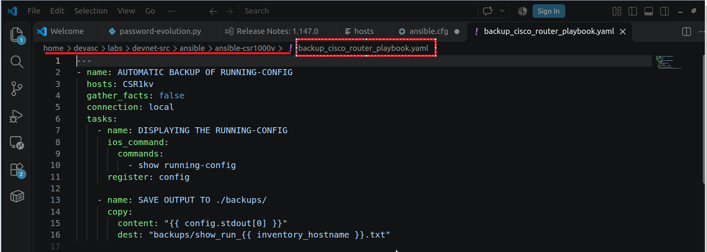
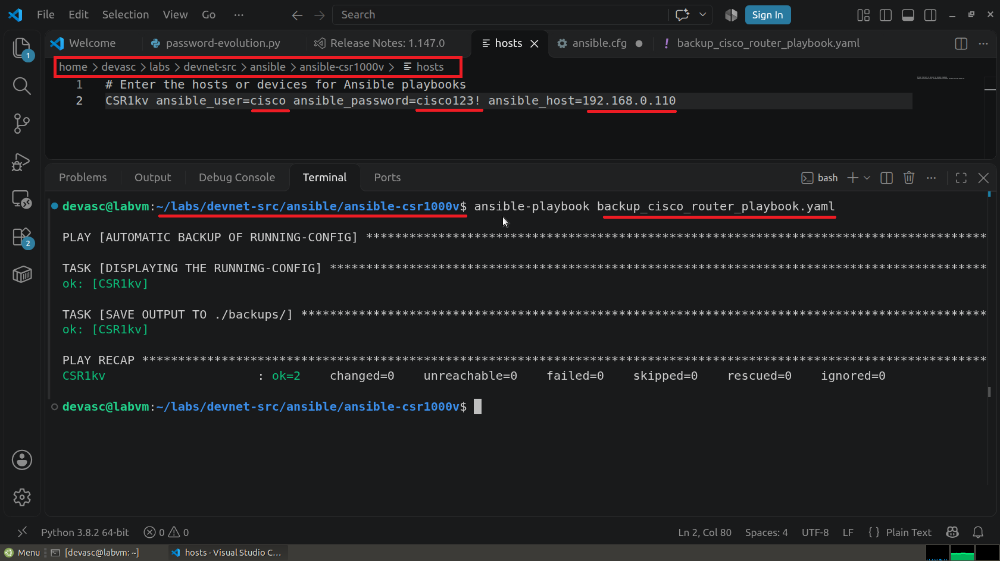
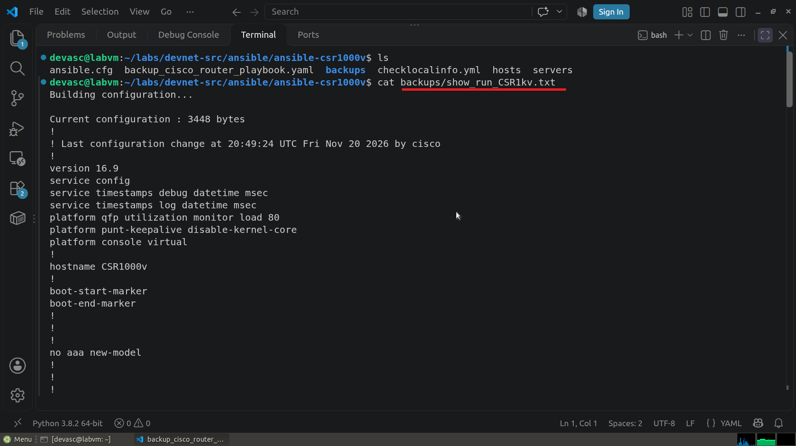

# TECHNICAL LOG & Ansible to Back Up and Configure a Device

## CISCO ANSIBLE 

**CCNP Miguelangel Luna**

---

## CONTENT:

| Case | Title | Description |
| :--- | :--- | :--- |
| **01** | [Claude & n8n AI Agents](./case-01-Google-Auth/) | Agentes Claude . |

[Google](https://www.google.com)


## 1. Introduction and Theoretical Framework

Use Ansible to Back Up and Configure a Device, objectives:

**Part 1:** Start the DEVASC VM and the CSR1000v VM.

**Part 2:** Configure Ansible.

**Part 3**: Use Ansible to back up the configuration.

**Part 4:** Use Ansible to configure a device (IPv6).


---

## Part 1: Start the VMs

Make sure your DEVASC virtual machine is powered on and running.

Make sure your CSR1000v virtual machine is powered on (with the IP 192.168.0.110 or whichever one your network has assigned to it).

From the DEVASC VM terminal, verify connectivity by pinging the router:

```text
ping 192.168.0.110
```

## Part 2: Configure Ansible.

The inventory file tells Ansible which devices to connect to.

**2.1)** Open the file named hosts located inside ansible-csr1000v.

```text
# Enter the hosts or devices for Ansible playbooks
CSR1kv ansible_user=cisco ansible_password=cisco123! ansible_host=192.168.0.110
```

Add the following line (or make sure it looks like this):



**2.2)** Verify the Ansible version.

Open a terminal in VS Code (or the Ubuntu terminal) and navigate to the parent folder to verify the installation:

```text
cd ~/labs/devnet-src/ansible/ansible-csr1000v
cd ..
ansible --version
```




**2.3)** Configure the local **ansible.cfg** file

To avoid using Ansible's global configuration (/etc/ansible/), we are going to tell Ansible to use the files in our current folder.

```text
cd ansible-csr1000v/
```

**2.4)** Open the **ansible.cfg** file in VS Code and leave it exactly like this (replacing the previous content):

```text
# config file for ansible-csr1000v
[defaults]
# Use local hosts file in this folder
inventory=./hosts
host_key_checking = False
retry_files_enabled = False
deprecation_warnings = False
```



## Part 3:  Use Ansible to back up the configuration.:

**3.1)** Use Ansible to Back Up the Configuration:

**3.1.1)** Create the Backup Playbook

In VS Code, inside the **ansible-csr1000v** folder, create a new file named: **backup_cisco_router_playbook.yaml**

```text
nano backup_cisco_router_playbook.yaml
```

Paste the following content **(backup_cisco_router_playbook.yaml)**:

```text
---
- name: AUTOMATIC BACKUP OF RUNNING-CONFIG
  hosts: CSR1kv
  gather_facts: false
  connection: local
  tasks:
    - name: DISPLAYING THE RUNNING-CONFIG
      ios_command:
        commands:
          - show running-config
      register: config

    - name: SAVE OUTPUT TO ./backups/
      copy:
        content: "{{ config.stdout[0] }}"
        dest: "backups/show_run_{{ inventory_hostname }}.txt"
```




**3.2)** Create the  backups **folder**, to save the config:

```text
mkdir backups
```

**3.3)**  Run the Playbook (In the VS Code terminal, backup_cisco_router_playbook.yaml):

Create the folder where the backup will be saved:

```text
ansible-playbook backup_cisco_router_playbook.yaml
```


**3.4)** Verify the config have been saved in backup folders:

You can open the backups folder in VS Code and you will see a file named show_run_CSR1kv.txt. Or you can view it from the terminal:

```text
cat backups/show_run_CSR1kv.txt
```



**Part 4:** Use Ansible to configure a device (IPv6).

**4.1)** Use Ansible to Configure IPv6 on the Device (Create the Configuration Playbook):

In VS Code, inside the **ansible-csr1000v folder**, create a new file named: **cisco_router_ipv6_config_playbook.yaml**

```text
---
- name: CONFIGURE IPv6 ADDRESSING
  hosts: CSR1kv
  gather_facts: false
  connection: local

  tasks:
    - name: SET IPv6 ADDRESS
      ios_config:
        parents: "interface GigabitEthernet1"
        lines:
          - description IPv6 ADDRESS
          - ipv6 address 2001:DB8:ACAD:1::1/64
          - ipv6 address FE80::1:1 link-local

    - name: SHOW IPv6 INTERFACE BRIEF
      ios_command:
        commands:
          - show ipv6 interface brief
      register: output

    - name: SAVE OUTPUT ./ios_configurations/
      copy:
        content: "{{ output.stdout[0] }}"
        dest: "ios_configurations/IPv6_output_{{ inventory_hostname }}.txt"
```


