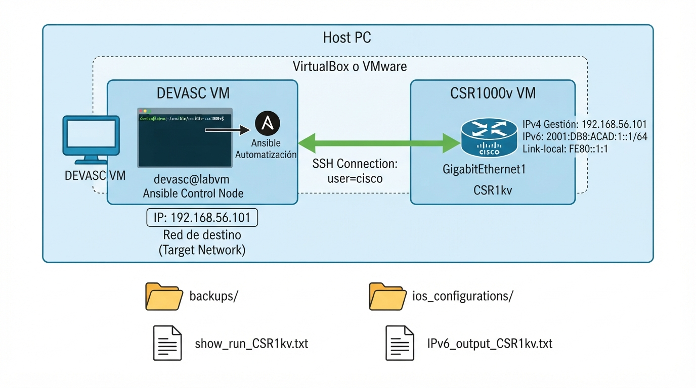

# TECHNICAL LOG & Ansible to Back Up and Configure a Device

## ANSIBLE CISCO

**CCNP Miguelangel Luna**

---

## CONTENT:

| Case | Title | Description |
| :--- | :--- | :--- |
| **01** | [Claude & n8n AI Agents](./case-01-Google-Auth/) | Agentes Claude . |

[Google](https://www.google.com)

## 1. Introduction and Theoretical Framework

The:

* **Local Scope:** It has meaning exclusively within the local router where it is configured and is not propagated via BGP routing updates to neighbors.

## 2. Topology and BGP Neighbor Establishment

The topology.



 four routers across different Autonomous Systems (AS 100, AS 200, AS 300, and AS 400). Before advertising prefixes, BGP neighbor adjacencies were established on each device.

## 3. BGP Configuration:

**Router:**

```text
router bgp 100
```
