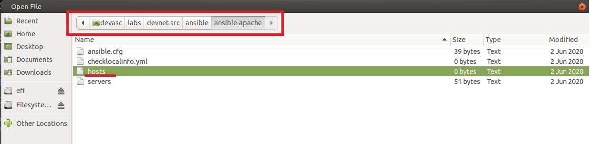
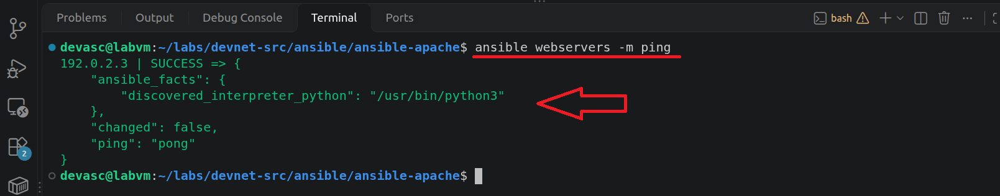
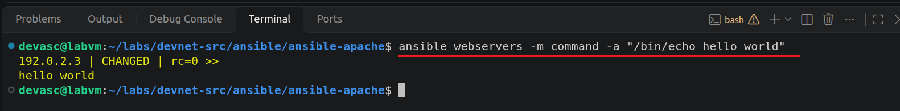
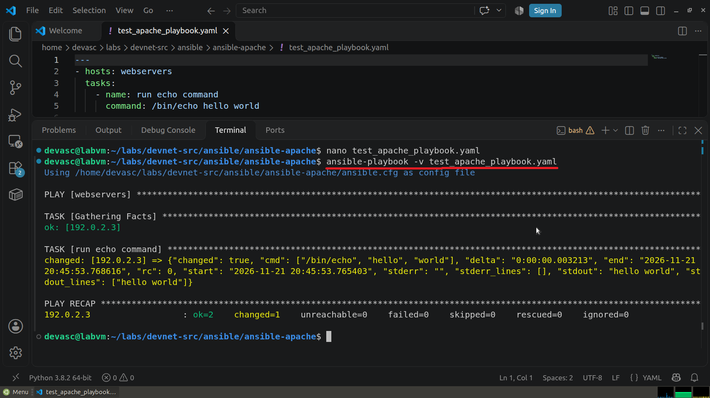

# TECHNICAL LOG & ANSIBLE WEB SERVER

## ANSIBLE
**CCNP Miguelangel Luna**

---

## CONTENT:

| Case | Title | Description |
| :--- | :--- | :--- |
| **01** | [Claude & n8n AI Agents](./case-01-Google-Auth/) | Agentes Claude . |

[Google](https://www.google.com)

## 1. Introduction and Theoretical Framework

**Part 1:** Start the DEVASC VM.

**Part 2:** Configure Ansible (Inventory and Configuration).

**Part 3:** Verify communication with the Local Web Server.

**Part 4:** Create Playbooks to automate the installation of Apache.

**Part 5**: Add options to the Playbook (Change the port to 8081).

## 2. Topology and BGP Neighbor Establishment


## 3. ANSIBLE IMPLEMENTACION:

**3.1)** Configurar Ansible (Inventario y Configuración):

By default, the SSH server is turned off in the DEVASC VM to save resources. Ansible needs it to be on in order to connect to itself. Run in the terminal:

```text
sudo systemctl start ssh
```
**3.2)** : Open the working directory in VS Code. Open VS Code.

Go to File > Open Folder... and navigate to /labs/devnet-src/ansible.

We will work inside the ansible-apache folder.

**3.3)** Edit the inventory file **(hosts)**

Open the hosts file inside ansible-apache.



[webservers]

```text
[webservers]
192.0.2.3 ansible_ssh_user=devasc ansible_ssh_pass=Cisco123!
```

**3.4)** Edit the **ansible.cfg** file
Open the **ansible.cfg** file inside **ansible-apache**.

Modify it so that it looks exactly like this:

```text
[defaults]
# Use local hosts file in this folder
inventory=./hosts
# Don't worry about RSA Fingerprints
host_key_checking = False
# Do not create retry files
retry_files_enabled = False
```

**3.5)** Verify Communications with the Local Web Server: Test connection with the ping module, from the VS Code terminal, make sure you are in the ansible-apache folder and run:

```bash
ansible webservers -m ping
```
**Expected result:** You should see a "ping": "pong" and SUCCESS.



**3.6)** Test command execution (command module)
Run a simple command on the remote server (which in this case is your own VM):

```bash
ansible webservers -m command -a "/bin/echo hello world"
```
**Expected result:** It should return hello world in the output section.



**3.7)** Probar ejecución de comandos (módulo command)

Parte 4: Crear Playbooks para Automatizar la Instalación de Apache
Paso 1: Crear Playbook de prueba

### 4. Create Playbooks to Automate the Installation of Apache:

**4.1)** Create a test Playbook

```bash
---
- hosts: webservers
  tasks:
    - name: run echo command
      command: /bin/echo hello world
```

**4.2)** Run the test Playbook

In the terminal, run:

```bash
ansible-playbook -v test_apache_playbook.yaml
```


**4.3)** Create the Apache installation Playbook

Create the file **install_apache_playbook.yaml** and paste this:

```bash
---
- hosts: webservers
  become: yes
  tasks:
    - name: INSTALL APACHE2
      apt: name=apache2 update_cache=yes state=latest

    - name: ENABLED MOD_REWRITE
      apache2_module: name=rewrite state=present
      notify:
        - RESTART APACHE2

  handlers:
    - name: RESTART APACHE2
      service: name=apache2 state=restarted
```


**4.4)** Run it in the terminal:

```bash
ansible-playbook -v install_apache_playbook.yaml
```
