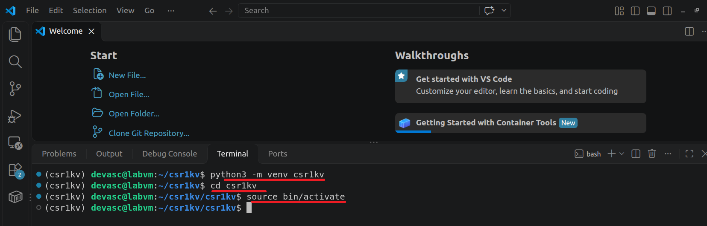
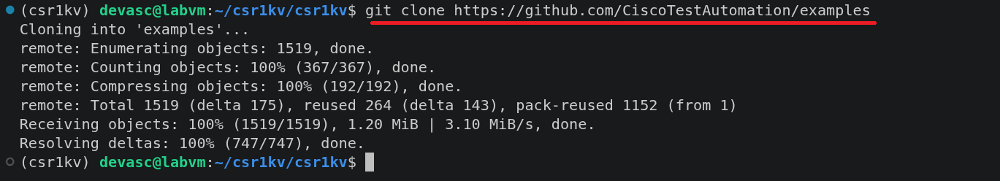
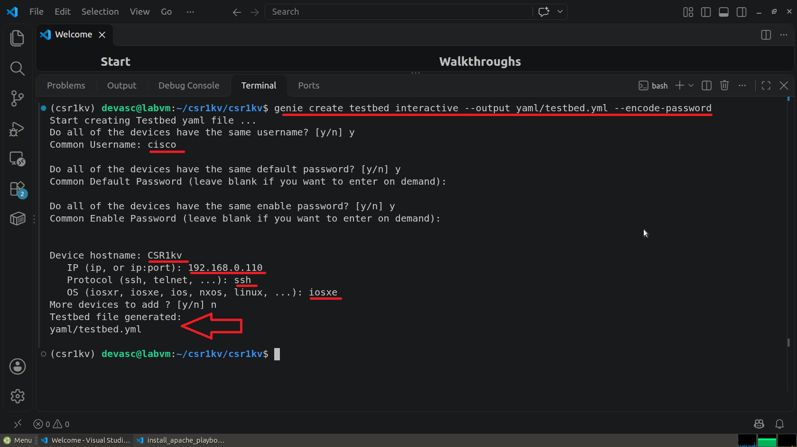
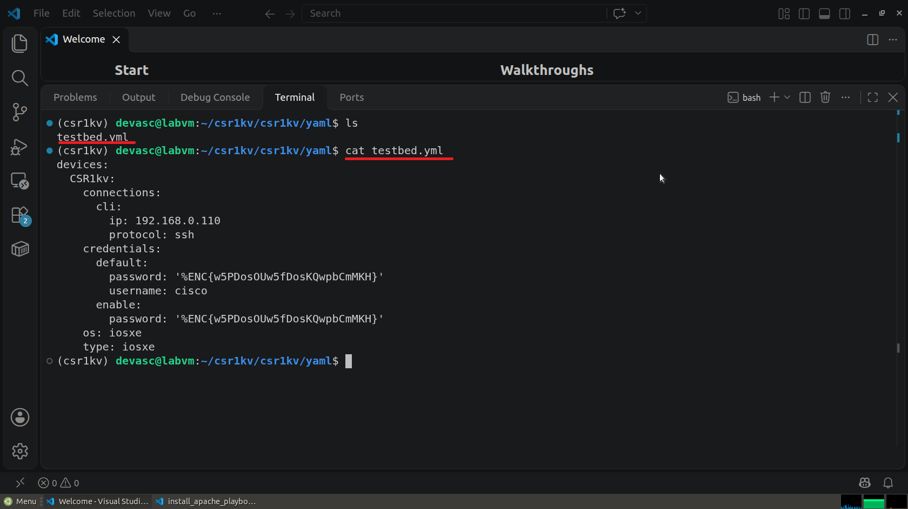

# TECHNICAL LOG & AUTOMATION ENGINEERING GUIDE

## Automated Testing Using pyATS and Genie
**CCNP Miguelangel Luna**

---

## CONTENIDOS:

| Case | Title | Description |
| :--- | :--- | :--- |
| **01** | [Claude & n8n AI Agents](./case-01-Google-Auth/) | Agentes Claude . |

[Google](https://www.google.com)

## 1. Introduction and Theoretical Framework

**In the world of programming and network automation, the difference between using loose scripts and using a framework is the same as the difference between building a house by buying bricks and cement on your own versus using a prefabricated structure with blueprints, foundations, and rules already defined.**

**pyATS (Framework) =** The infrastructure for organizing, running, and reporting automated network tests in a professional way. Specifically, pyATS is useful for Standardizing the testing cycle: It divides your automations into three clear phases:

**A)** Setup (prepare the environment and connect to the router).

**B** Test (run commands, apply changes, or verify states).

**C)** Cleanup (leave the device as clean as it was before).

**D)** Centralized inventory (Testbed): Instead of putting IP addresses, usernames, and passwords inside your Python code, pyATS uses a YAML file (testbed.yaml) where you describe your entire network topology (routers, switches, interfaces, and credentials).

**E)** Automatic reports and logs: When a run finishes, pyATS generates detailed reports indicating exactly which tests passed (PASSED), which failed (FAILED), and saves the evidence in organized logs without you having to program it.

**Genie (Toolbox) =** The network intelligence inside pyATS that understands router CLI, converts text into structured data (JSON/dictionaries), and detects changes in the network before and after a configuration. If pyATS is the engine and testing structure, Genie is the **"network-specialized toolbox"** built on top of pyATS (and it is the main reason we will install pyats[full]).

When you connect to a Cisco**CSR 1000v** router via CLI, the router responds with plain text designed for humans (for example, the table from show ip interface brief or show ip route). Processing that text with regular expressions in Python is slow and error-prone. Genie solves this in three ways:

Parsers (syntactic analyzers): Genie includes thousands of ready-to-use parsers for Cisco devices (IOS, IOS-XE, NX-OS, IOS-XR) and other vendors. You pass it the text output of a command such as show ip interface brief and Genie automatically returns it converted into a clean Python dictionary / JSON, where you can directly query output['interface']['GigabitEthernet1']['ip_address'].

State learning and comparison (Diff): With a single command (genie learn ospf or genie learn routing), Genie captures a complete "snapshot" of how your network is operating before a change (for example, a maintenance window), captures another one after the change, and shows you exactly what changed (which neighbor went down, which route disappeared, or which interface changed state).

Agility from the terminal: You can use Genie directly from the Linux command line without even writing a Python script yet (for example: genie parse "show version" --testbed-file testbed.yaml).


**Project Objectives:**

**Parts 1 and 2:** Create a Python virtual environment (venv).

**Part 3:** Install and use the pyATS testing library.

**Part 4:** Use Genie to parse IOS command output into JSON.

**Part 5:** Use Genie to compare configurations.

**Part 6:** Cleanup and exploration.

## 2. Topology and BGP Neighbor Establishment

The


## 3. IMPLEMENTATION:

**Parts 1 and 2:** Create a Python virtual environment (venv).
We are going to create an "isolated space" to install pyATS without affecting the VM's base system.

**1.1) Create the working folder and enter it::**

```text
python3 -m venv csr1kv
```

What does each part mean?

**python3:** Runs the Python 3 interpreter on your system.

**-m venv:** Tells Python to run the venv module (included by default in Python 3.3+) as a script to create virtual environments.

**csr1kv:** This is the name (and the folder) that will be given to the virtual environment. In this case, it is usually used as a folder or project name related to the Cisco CSR 1000v virtual router (for example, for network automation scripts with Netmiko, NAPALM, Ansible, or pyATS).


**1.2) Enter the virtual environment:**

```text
cd csr1kv
source bin/activate
```


**Part 2:** Use the pyATS Testing Library

**2.1) Install pyATS**

Inside the virtual environment (make sure you see (csr1kv) in your terminal), run:

```text
pip3 install pyats[full]
```

The command pip3 install pyats[full] downloads and **installs the Cisco pyATS framework** along with all its optional packages **and extensions (such as Genie, parsers, connectors, and network testing libraries).**

Breakdown of the command:

**pip3:** The Python 3 package manager (if you already have the csr1kv virtual environment activated, you can just type pip).

**install:** Instruction to download and install the package from the official PyPI repository.

**pyats:** The core of Python Automated Test Systems, Cisco's tool for automating tests, validations, and operations on network devices (such as the CSR 1000v router).

**[full]:** This is a modifier ("extra") that tells pip not to install only the minimal base of pyats, but the complete package, including Genie (which brings thousands of ready-to-use parsers to convert CLI output into JSON/Python dictionaries, data models, and network state comparison tools).

(This command will download quite a few packages. It may take a few minutes. If you see some compilation errors along the way, they can usually be ignored as long as the installation finishes.)

**2.2) Verify the installation**

Verify that it was installed correctly by running:

```text
pyats --help
```

**2.3)  Clone the example scripts:**

Let's download Cisco's official example scripts:

```text
git clone https://github.com/CiscoTestAutomation/examples
```



**2.4)  Let's run the example script to see how pyATS works. Run:**

```text
pyats run job examples/basic/basic_example_job.py
```
**Part 3:** Connect to the Router (Genie).

This is the most exciting part. We are going to use Genie to connect to your CSR1000v and convert plain text into structured data (JSON).

(Make sure you are still inside your virtual environment, that is, your prompt should still start with (csr1kv).)

**3.1)** Create the Testbed file (YAML)

The **"Testbed"** file tells Genie which device to connect to and with which credentials. We will create it with an interactive wizard.

Run this command in your terminal:

```text
genie create testbed interactive --output yaml/testbed.yml --encode-password
```

Note:  This command will create the testbed.yml file at the path (yaml/testbed.yml) interactively.






**3.2)**  Parse a command **(Convert text to JSON)**

Now that Genie knows your router, let's ask it to run the show version command and show us the result in JSON format.

Run this command (all on a single line):

```text
genie parse "show version" --testbed-file yaml/testbed.yml --devices CSR1kv
```

### 4. BGP Configuration:


