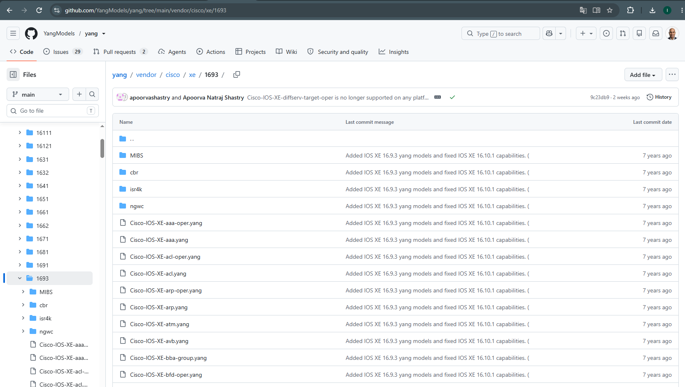
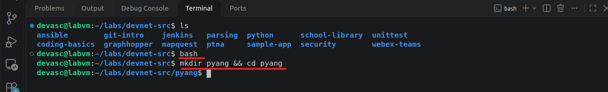
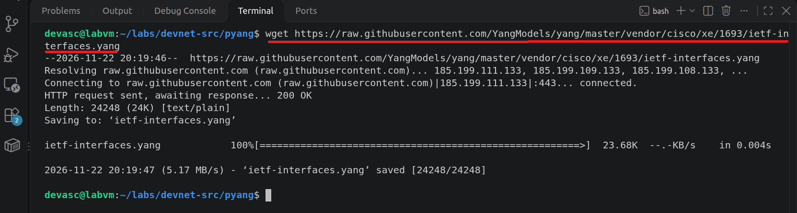
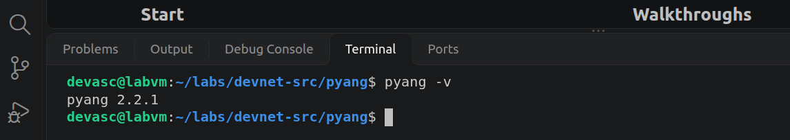

# TECHNICAL LOG & AUTOMATION ENGINEERING GUIDE

## YANG MODELS
**CCNP Miguelangel Luna**

---

## CONTENIDOS:

| Case | Title | Description |
| :--- | :--- | :--- |
| **01** | [Claude & n8n AI Agents](./case-01-Google-Auth/) | Agentes Claude . |

[Google](https://www.google.com)

## 1. Introduction and Theoretical Framework

**YANG:** es la estructura y reglas de los datos y el JSON es la formato de datos.

**YANG =** La estructura y las reglas.

**JSON =** El formato de los datos.

Para que se te quede grabado como un concepto de arquitectura sólida, piensa en cómo funciona una base de datos relacional (como MySQL o PostgreSQL):

YANG es el "Esquema de la Tabla" (Schema): Cuando creas una tabla, defines que la columna "Edad" debe ser un número entero (INT), y la columna "Nombre" debe ser texto (VARCHAR). La base de datos no te dejará guardar la palabra "veinte" en la columna Edad. Eso es YANG.

JSON es la "Fila" (Row): Es el registro real que insertas. Es el {"Nombre": "Carlos", "Edad": 30}. Eso es JSON.
---------------------------------------------------------------------------------------

Explore YANG Models
Objectives

**Part 1:** Start the DEVASC VM.

**Part 2:** Explore a YANG model on GitHub and download it to the VM.

**Part 3:** Use pyang to transform the YANG model into a readable format (tree).

File structure:

```bash
yang-lab/
├── ietf-interfaces.yang
├── ietf-yang-types.yang
└── tree-output.txt
```

# Exploración de Modelos YANG con pyang

Este laboratorio demuestra cómo usar la herramienta `pyang` para visualizar y validar modelos de datos YANG, que son la base para la configuración de dispositivos de red modernos mediante APIs (RESTCONF, NETCONF).

## Archivos del Proyecto
- `ietf-interfaces.yang`: Modelo estándar de la IETF que define cómo se configuran y monitorean las interfaces de red.
- `ietf-yang-types.yang`: Archivo de dependencias necesario para que el modelo principal compile sin errores.
- `tree-output.txt`: Salida generada por `pyang` en formato árbol.

## Conceptos Clave del Formato "Tree"
- **`rw` (Read-Write):** Nodos que representan configuración que podemos modificar (ej. el `enabled` de una interfaz).
- **`ro` (Read-Only):** Nodos que representan el estado actual del dispositivo (ej. contadores de tráfico, estado operativo).
- **`?` (Opcional):** El campo puede no estar presente.
- **`*` (Múltiple):** Puede haber varias instancias de este nodo (como las múltiples interfaces de un router).
- **`[name]`:** Es la clave (Key) o identificador único del nodo.

## Comandos Utilizados
```bash
# Descargar el modelo y su dependencia
wget https://raw.githubusercontent.com/YangModels/yang/master/vendor/cisco/xe/1693/ietf-interfaces.yang
wget https://raw.githubusercontent.com/YangModels/yang/master/standard/ietf/RFC/ietf-yang-types.yang

# Transformar a formato árbol
pyang -f tree ietf-interfaces.yang


## 2. Topology and BGP Neighbor Establishment


## 3. IMPLEMENTATION:

**3:1)** Explore the model in the browser

Open the Chromium browser inside the DEVASC VM.

Go to the URL: **https://github.com/YangModels/yang**

On the master branch, navigate through the folders until you reach the IOS XE 16.9.3 version:

vendor > cisco > xe > 1693

Look for the **ietf-interfaces.yang** file and open it.



You will see the source code of the model. If you are familiar with Cisco's show interfaces, you will see concepts such as leaf enabled (which is a boolean that indicates whether the interface is active or not).


```bash
   cd ~/labs/devnet-src
```

Create the pyang folder and enter it:

```bash
bash
mkdir pyang && cd pyang
```


Download the file directly using wget (we'll use the GitHub "Raw" URL):

```bash
wget https://raw.githubusercontent.com/YangModels/yang/master/vendor/cisco/xe/1693/ietf-interfaces.yang
```


**4:1)** Explore a YANG Model Using pyang:

pyang is an open-source tool that validates YANG models and transforms them into formats that are much easier for humans to read.

Step 1: Verify that pyang is installed
In the terminal, run:

```bash
pyang -v
```


**4:1)** Transform the model (Tree format)
The most useful format in pyang is "tree", which shows us the model's hierarchy as if it were a family tree.

Run the following command to transform the file you downloaded:

```bash
pyang -f tree ietf-interfaces.yang
```

```bash
wget https://raw.githubusercontent.com/YangModels/yang/master/standard/ietf/RFC/ietf-yang-types.yang
```
