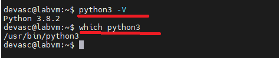
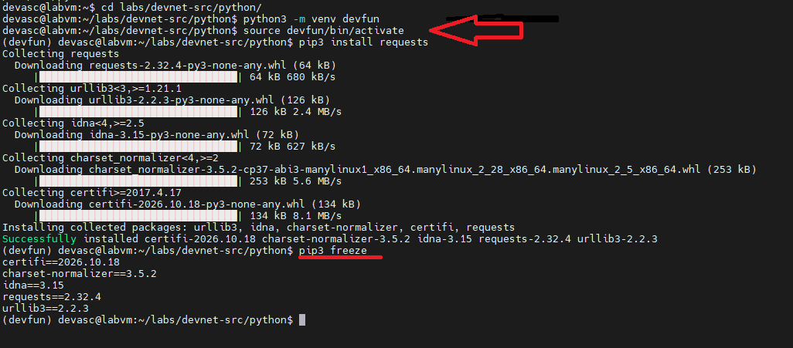

# TECHNICAL LOG & Explore Python Development Tools (Cisco DevNet)

## Python Tools
**CCNP Miguelangel Luna**

---

## CONTENIDOS:

| Case | Title | Description |
| :--- | :--- | :--- |
| **01** | [Claude & n8n AI Agents](./case-01-Google-Auth/) | Agentes Claude . |

[Google](https://www.google.com)

## 1. Introduction and Theoretical Framework

This repository documents the practical lab **"Explore Python Development Tools"** from the Cisco DevNet Associate (DEVASC) curriculum. The main objective of this practice is to master Python development environment management, package handling with `pip`, and best practices to prevent dependency conflicts in automation projects.

## 🛠️ Tools & Technologies Used

* **Python 3.8.2**
* **Python `venv` module** for virtual environments
* **PIP (Pip Installs Packages)** for package management
* **Operating System:** DEVASC Virtual Machine (Linux).

## 🚀 Lab Objectives
* Review and validate the local Python installation and execution paths within the DEVASC Virtual Machine.
* Understand the importance of **Python virtual environments** (`venv`) for isolating project dependencies.
* Learn how to freeze, export, and share project dependencies using a `requirements.txt` file.
* Simulate multi-developer workflows by installing required packages from a shared configuration file.


### 2. Review Python Installation

## 📋 Step-by-Step Instructions

**2.1)** Verify the installed Python version and its directory path in the system:

```bash
python3 -V
which python3
```



**2.2)** Create and Use Python Virtual Environments

To prevent competing software versions and system-wide dependency conflicts, create an isolated workspace:

Navigate to the target directory

```bash
cd labs/devnet-src/python/
```

**2.3)** Create a virtual environment named 'devfun'

```bash
python3 -m venv devfun
```

**2.4)** Activate the virtual environment

```bash
source devfun/bin/activate
```

**2.5)** Install the requests package inside the isolated environment

```bash
pip3 install requests
```

**2.6)** Verify the packages installed in the active environment

```bash
pip3 freeze
```




