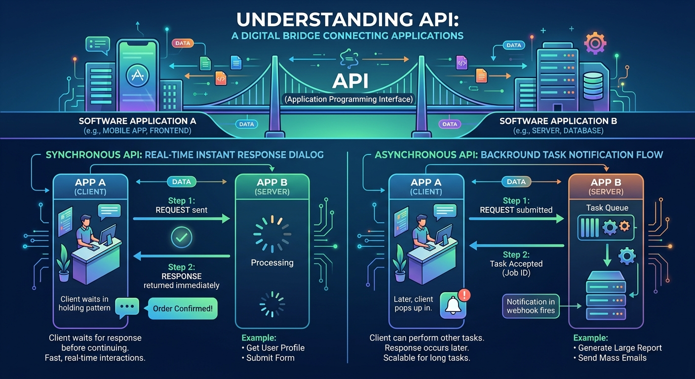
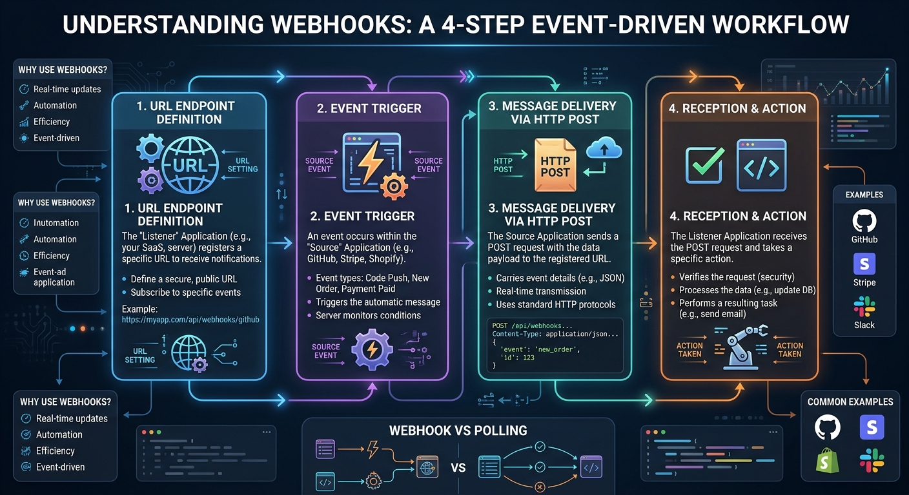

# TECHNICAL LOG & API

## API
**CCNP Miguelangel Luna**

---

## CONTENIDOS:

| Case | Title | Description |
| :--- | :--- | :--- |
| **01** | [Claude & n8n AI Agents](./case-01-Google-Auth/) | Agentes Claude . |

[Google](https://www.google.com)

## 1. Introduction and Theoretical Framework

**API:** It is a "bridge" or interface that allows two software systems to communicate with each other, facilitating the use of another application's features without needing to know its internal code.

**Synchronous API:** It is one in which the client (the application making the request) sends a request and waits for the server to process the information and return the response in real time. During that time, the connection remains open and the process typically blocks until the result is received.

**Asynchronous API:** It is one in which the client sends a request and the server only confirms that it has received it (for example, by returning an acceptance code), without waiting for the task to finish. The server processes the operation in the background and, when completed, notifies the client through a notification (such as a webhook), a message, or by allowing the client to check the status later (polling).



**Webhook:** is an automated communication mechanism between applications. In simple terms, **it is an event-based real-time notification.** It allows one application to automatically send data to another application only when a specific event occurs, instead of the second application having to constantly ask if there are updates.

**How does a Webhook work?**

1. **URL (Endpoint) Definition:** The client application provides a web address (URL) to the server.
2. Event Trigger: An action occurs on the server (for example: a customer makes a payment).
3. Message Delivery: The server automatically sends an HTTP request (usually via a POST request) with the event details to the registered URL.
4. Reception and Action: Your application receives the notification and immediately performs the corresponding action (for example: sends the invoice by email).



   
## 2. Topology and BGP Neighbor Establishment


## 3. BGP Configuration:

**Router A (RTA - AS 100):**

```text
! 
router bgp 100
!
```

### 4. BGP Configuration:


