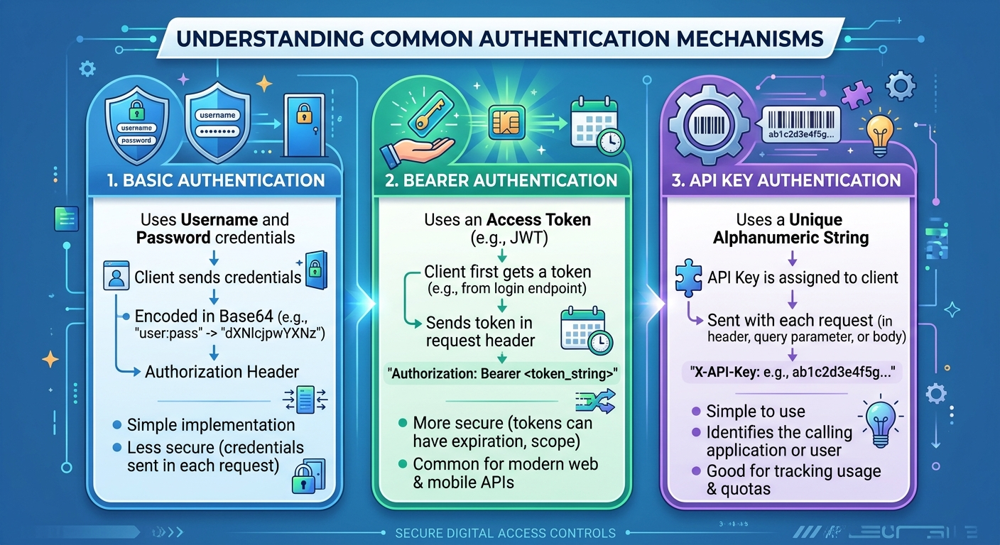

# TECHNICAL LOG & API

## API
**CCNP Miguelangel Luna**

---

## CONTENIDOS:

| Case | Title | Description |
| :--- | :--- | :--- |
| **01** | [Claude & n8n AI Agents](./case-01-Google-Auth/) | Agentes Claude . |

[Google](https://www.google.com)

## 1. Introduction and Theoretical Framework

**API:** It is a "bridge" or interface that allows two software systems to communicate with each other, facilitating the use of another application's features without needing to know its internal code.

**Synchronous API:** It is one in which the client (the application making the request) sends a request and waits for the server to process the information and return the response in real time. During that time, the connection remains open and the process typically blocks until the result is received.

**Asynchronous API:** It is one in which the client sends a request and the server only confirms that it has received it (for example, by returning an acceptance code), without waiting for the task to finish. The server processes the operation in the background and, when completed, notifies the client through a notification (such as a webhook), a message, or by allowing the client to check the status later (polling).


**Webhook:** is an automated communication mechanism between applications. In simple terms, **it is an event-based real-time notification.** It allows one application to automatically send data to another application only when a specific event occurs, instead of the second application having to constantly ask if there are updates.

**How does a Webhook work?**

1. **URL (Endpoint) Definition:** The client application provides a web address (URL) to the server.
2. **Event Trigger:** An action occurs on the server (for example: a customer makes a payment).
3. **Message Delivery:** The server automatically sends an HTTP request (usually via a POST request) with the event details to the registered URL.
4. **Reception and Action:** Your application receives the notification and immediately performs the corresponding action (for example: sends the invoice by email).


**Common API Architectural Styles**

Although an application can create a freeform or unstructured interface to interact with third parties, the best practice is to follow specific standards, protocols, and architectural styles. This makes it much easier for developers to understand and use the API, as the concepts will be familiar to them.
The three most popular API architectural styles are:
1. **RPC (Remote Procedure Call):** Is a request-response model that lets an application (acting as a client) make a procedure call to another application (acting as a server). The "server" application is typically located on another system within the network.

RPC is an API style that can be applied to different transport protocols. Example implementations include:
- XML-RPC
- JSON-RPC
- NFS (Network File System)
- Simple Object Access Protocol (SOAP)

2. **SOAP (Simple Object Access Protocol):** SOAP is a messaging protocol. It is used for communicating between applications that may be on different platforms or built with different programming languages. It is an XML-based protocol that was developed by Microsoft. SOAP is commonly used with HyperText Transfer Protocol (HTTP) transport, but can be applied to other protocols. SOAP is independent, extensible, and neutral.
   
4. **REST (Representational State Transfer):** REST as a hybrid style, derived from several network-based architectural styles he described elsewhere in the paper, "combined with additional constraints that define a uniform connector interface."


**Authentication Mechanisms**

Common types of authentication mechanisms include Basic, Bearer, and API Key.

1) **Basic authentication:** also known as Basic Auth, uses the standard Basic HTTP authentication scheme. Basic Auth transmits credentials as username/password pairs separated with a colon ( : ) and encoded using Base64. Basic Auth is the simplest authentication mechanism. It is extremely insecure unless it is paired with requests using HTTPS rather than HTTP. Although the credentials are encoded, they are not encrypted. It is simple to decode the credentials and get the username/password pair.

In a REST API request, the Basic Auth information will be provided in the header:

**`Authorization: Basic <username>:<password>`**

2)**Bearer authentication:** Also known as Token Authentication, uses the standard Bearer HTTP authentication scheme. It is more secure than Basic Authentication and is typically used with **OAuth**and **Single Sign-On (SSO)**. Bearer Authentication uses a **bearer token, which is a string generated by an authentication server such as an Identity Service (IdS).**

In a REST API request, the Bearer Auth information will be provided in the header:

**`Authorization: Bearer <bearer token>`**

Just like Basic Authentication, **Bearer Authentication should be used with HTTPS.**

3)**API key:** Also referred to as an API Token, is a unique alphanumeric string generated by the server and assigned to a user. To obtain a unique API key, the user typically logs into a portal using their credentials. **This key is usually assigned one time and will not be regenerated.** All REST API requests for this user must provide the assigned API key as the form of authentication.

Just as with the other types of authentication, **API keys are only secure when used with HTTPS.**

API keys are intended to be an authentication mechanism, but are commonly misused as an authorization mechanism.



**The two types of API keys are:**

- **Public:** It can be shared and provides access to a subset of the data.
- **Private:** It is secret (like a username and password); if compromised, it grants indefinite access to the system, as most do not expire or regenerate.


A REST API request can provide an API key in a few different ways:

- **Query string:** Only recommended for public API keys
- **Header:** Authorization key or a custom key (**`Authorization: <API Key>`** or **`Authorization: APIkey <API Key>` or `APIkey: <API Key>`**)
- **Body data:** Uses a unique key as the identifier **(`Content-Type: application/json`)**
- **Cookie:** Uses a unique key as the identifier **(`Cookie: API_KEY=<API Key>`)**

**Authorization Mechanisms**

Open Authorization, also known as **OAuth, combines authentication with authorization**. OAuth was developed as a solution to insecure authentication mechanisms. With increased security compared to the other options, it is usually the recommended form of authentication/authorization for REST APIs.

There are two versions of OAuth:

1) OAuth 1.0
2) OAuth 2.0. **Most of today's REST APIs implement OAuth 2.0. Note that OAuth 2.0 is not backwards compatible.**

Defined in the OAuth 2.0 Authorization Framework, “OAuth 2.0 authorization framework enables a third-party application to obtain limited access to an HTTP service, either on behalf of a resource owner by orchestrating an approval interaction between the resource owner and the HTTP service, or by allowing the third-party application to obtain access on its own behalf.”

Essentially, OAuth 2.0 enables pre-registered applications to get authorization to perform REST API requests on a user's behalf without the user needing to share their credentials with the application itself. OAuth lets the user provide credentials directly to the authorization server, typically an Identity Provider (IdP) or an Identity Service (IdS), to obtain an access token that can be shared with the application.

This process of obtaining the token is called a flow. The application then uses this token in the REST API as a Bearer Authentication. The web service for the REST API then checks the Authorization server to make sure that the token is valid, and that the requester is authorized to perform the request.

   
## Exploring REST APIs with API Simulator and Postman

This repository documents the lab exercise for exploring, consuming, and automating requests to a REST API using a Cisco DEVASC virtual machine, interactive documentation tools (OpenAPI/Swagger), **Postman**, and a **Python** automation script.

---

## 📋 Lab Objectives
1. **Launch and configure** the DEVASC Virtual Machine environment.
2. **Explore the API documentation** using the school library simulator and OpenAPI specifications.
3. **Perform HTTP calls** (GET, POST, DELETE) using Postman and cURL.
4. **Automate data insertion** (100 random books) using a Python script with the `faker` library.

---

## 🛠️ Technologies and Tools Used
- **Environment:** DEVASC Virtual Machine (VirtualBox / VMware).
- **API Simulator:** School Library API (`http://library.demo.local`).
- **API Client:** Postman.
- **Programming Language:** Python 3 (with `requests` and `faker` libraries).

---

## 🚀 Lab Development

### Part 1: Launching the Virtual Machine
- The DEVASC VM environment was booted up, which includes the school library API simulator and its local database.

### Part 2: Exploring the Documentation (API Simulator)
1. **Website Access:** Using the Chromium browser, navigated to `http://library.demo.local` to view the book catalog.
2. **OpenAPI Documentation:** Accessed the API documentation section (`/api/v1`) to study the available namespaces and endpoints.
3. **Testing with `GET /books`:** Using the *Try it out* feature, executed a request to list existing books in JSON format and tested the `includeISBN=true` parameter.
4. **Basic Authentication (`POST /loginViaBasic`):** 
   * Sent default credentials (`cisco` / `Cisco123!`) to retrieve an access token.
   * Authorized the session in the interface using the token under the `X-API-KEY` header.
5. **CRUD Operations:**
   * Added books via `POST /books`.
   * Queried specific books using `GET /books/{id}`.
   * Deleted records using `DELETE /books/{id}`.

### Part 3: Using Postman to Consume the API
Replicated the previous requests using Postman to become familiar with managing collections and requests outside the browser:
1. **GET Request:** Configured a GET request to `http://library.demo.local/api/v1/books` to verify the `200 OK` status and the JSON response.
2. **POST with Basic Auth:** Configured the *Authorization* tab in Postman by selecting *Basic Auth* to authenticate and retrieve the token.
3. **POST with API Key:** Configured API Key authentication (`X-API-KEY`) and sent a raw JSON payload to add the book *IPv6 Fundamentals*.
4. **Query Parameters:** Integrated parameters like `includeISBN=true` and `sortBy=author` to sort and filter responses directly from Postman.

### Part 4: Automation with Python (`add100RandomBooks.py`)
To avoid manual data entry, analyzed and executed a Python script that bulk-generates mock data:
1. **Main Libraries:**
   * `requests`: To make HTTP requests (GET, POST) from the script.
   * `json`: For handling structured payloads.
   * `faker`: For dynamically generating fake titles, authors, and ISBNs.
2. **Script Functions:**
   * `getAuthToken()`: Automatically authenticates against the `/api/v1/loginViaBasic` endpoint using credentials and returns the session token.
   * `addBook()`: Sends POST requests to the `/api/v1/books` endpoint, attaching the token in the header (`X-API-Key`) and the generated book in JSON format.
3. **Execution:**
   Ran the script from the virtual machine terminal:
   ```bash
   python3 add100RandomBooks.py


