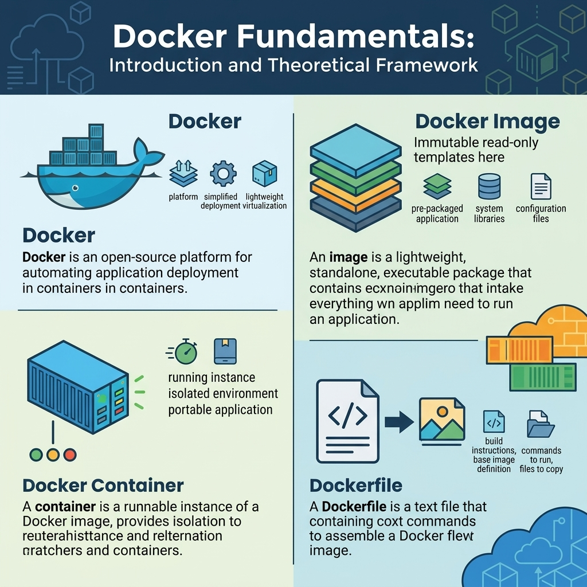
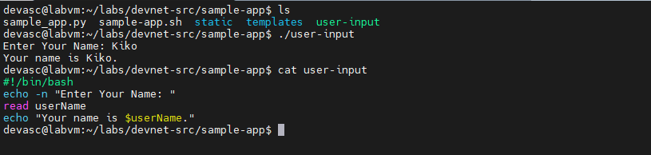
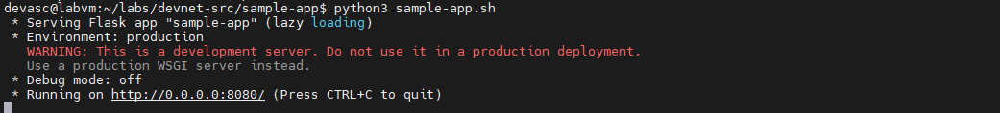
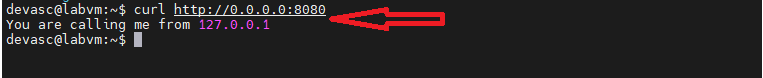
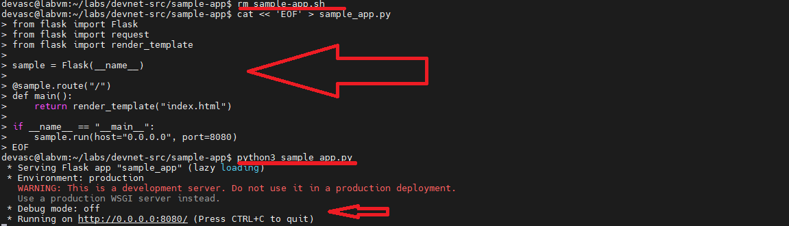
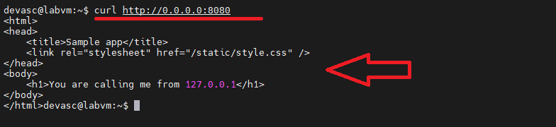
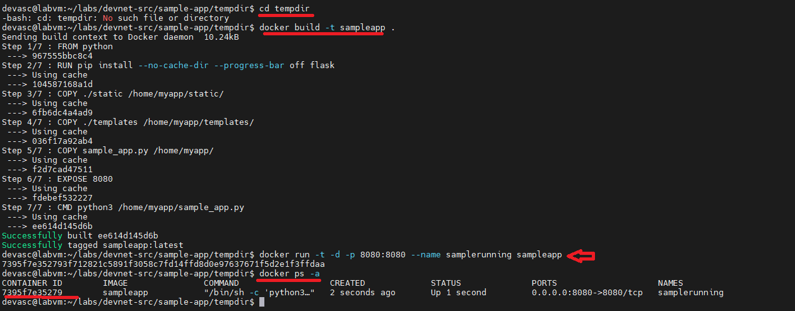
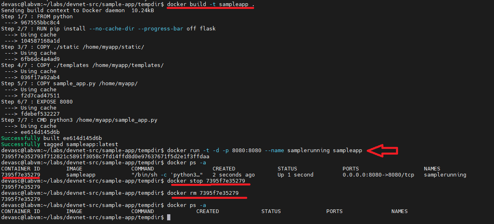
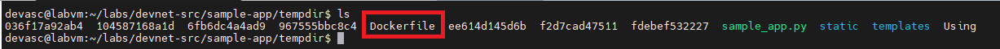
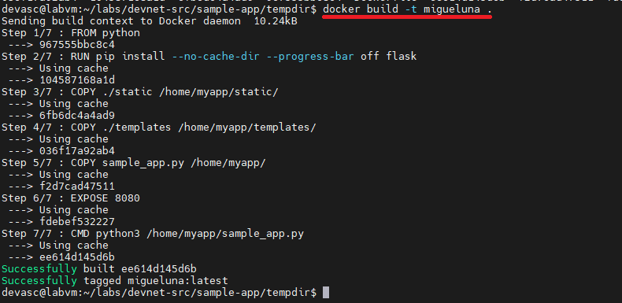

# TECHNICAL LOG & DOCKER CONTAINER

## DOCKER CONTAINERS
**CCNP Miguelangel Luna**

---

## CONTENIDOS:

| Case | Title | Description |
| :--- | :--- | :--- |
| **01** | [Claude & n8n AI Agents](./case-01-Google-Auth/) | Agentes Claude . |

[Docker](https://www.netacad.com/es/)

## 1. Introduction and Theoretical Framework

1. **What is Docker?**
Docker is an open-source platform that enables developers to build, ship, and run applications inside isolated environments called containers. By packing an application together with all of its dependencies, libraries, and configuration files, Docker ensures that the software runs reliably across any computing environment—whether on a local development machine, a virtual machine, or a cloud server.

2. **Docker Image**
A Docker image is a read-only, immutable template that contains instructions for creating a Docker container. It includes the application code, runtime, libraries, environment variables, and dependency configuration files. Images serve as the building blocks for containers; they can be built locally using a configuration file or downloaded from registries like Docker Hub.

3. **Docker Container**
A Docker container is a runnable, isolated instance of a Docker image. Containers utilize lightweight virtualization, sharing the host operating system's kernel while keeping processes, network interfaces, and file systems completely segregated. They can be created, started, stopped, moved, and deleted using the Docker CLI.

4. **Dockerfile**
A Dockerfile is a text document containing a sequential set of automated commands and instructions used by the Docker daemon to build a Docker image. Key instructions commonly used include:
- `FROM`: Specifies the base image (e.g., Python) to start the build process.
- `RUN`: Executes commands inside the image layer (such as installing packages via pip).
- `COPY`: Transfers files and directories from the host machine into the container's file system.
- `EXPOSE`: Informs Docker that the container listens on specific network ports at runtime.
- `CMD`: Defines the default command to execute when the container starts running.


  

## 2. Build a Sample Web App in a Docker Container
 
**Part 2.1:** Launch the DEVASC VM

* Launch the DEVASC Virtual Machine using VirtualBox or VMWare.

Bash scripting is a prerequisite for automation, CI/CD, and managing development environments. 

2.1 **Create and navigate to the working directory**:
   
```bash
   cd labs/devnet-src/sample-app/
```
```bash
   touch user-input.sh
```

2.2 **Open the file in nano and add the shebang and script logic:**

```bash
   nano user-input.sh
```

2.3 **Add the initial content (the shebang line and the commands to prompt for the name):**

```bash
   #!/bin/bash
   echo -n "Enter Your Name: "
   read userName
   echo "Your name is $userName."
```
2.4 **Grant execution permissions and rename the file:**

```bash
   chmod a+x user-input.sh
```
```bash
   mv user-input.sh user-input
```



3. **Moving on to Part 3: Create a Sample Web App**

In this part, we will create a simple Python web application using the **Flask** framework, which will display the IP address of the client making the request.

Follow these steps in your terminal inside the DEVASC VM:

3.1 **Install Flask and open the port in the firewall (if necessary):**
   
```bash
sudo apt update && sudo apt install -y python3-pip
pip3 install flask
```

3.2 **Create / open the `sample_app.py` file:**

```bash
nano sample_app.py
```

```bash
from flask import Flask
from flask import request

sample = Flask(__name__)

@sample.route("/")
def main():
    return "You are calling me from " + request.remote_addr + "\n"

if __name__ == "__main__":
    sample.run(host="0.0.0.0", port=8080)
```
```bash
python3 sample-app.sh
```



3.3 **Open another terminal and use curl:**

```bash
curl http://0.0.0.0:8080
```


4 **Moving on to Part 4: Configure the Web App to Use Website Files**

Now we will expand our application to use static HTML and CSS files instead of returning plain text directly from Python.

Follow these steps in your terminal (make sure you stopped the previous server with `CTRL + C` if it was still running):

4.1 **Explore the existing directories (`templates` and `static`):**

Previous folders with `index.html` and `style.css` already exist. You can check their content with:

```bash
   cat templates/index.html
   cat static/style.css
```

4.2 **Update the `sample_app.py` code:**

Edit your `sample_app.py` file to import `render_template` and render the HTML template.

```bash
cat << 'EOF' > sample_app.py
from flask import Flask
from flask import request
from flask import render_template

sample = Flask(__name__)

@sample.route("/")
def main():
    return render_template("index.html")

if __name__ == "__main__":
    sample.run(host="0.0.0.0", port=8080)
EOF
```

```bash
python3 sample_app.py
```



```bash
curl http://0.0.0.0:8080
```



4.3 **Update the `sample_app.py` code:**

Add the commands to create temporary directories and copy files:

Write the following content to the file:

```bash
#!/bin/bash
mkdir tempdir
mkdir tempdir/templates
mkdir tempdir/static

cp sample_app.py tempdir/.
cp -r templates/* tempdir/templates/.
cp -r static/* tempdir/static/.
```

4.4 **Add the commands to create temporary directories and copy files (The following files are used to build the Homepage packed in docker):**
Write the following content to the file:

- **`sample_app.py`:** The backend Python Flask code that serves the web application and listens for incoming requests.
- **`templates/`:** Contains the HTML files (the frontend layout/homepage structure) that Flask renders.
- **`static/`:** Contains supporting assets like CSS stylesheets, JavaScript, or images used by the homepage.
- **`sample-app.sh`:** The automation script you'll look at next in the lab, which programmatically writes a Dockerfile, gathers these files, and builds the Docker image.

```bash
#!/bin/bash
mkdir tempdir
mkdir tempdir/templates
mkdir tempdir/static

cp sample_app.py tempdir/.
cp -r templates/* tempdir/templates/.
cp -r static/* tempdir/static/.
```
4.5 **Create the Dockerfile:**

- **`echo "FROM python" > tempdir/Dockerfile`:** Creates the new Dockerfile (using `>`) and defines the base Python image that the container will use.
- **`echo "RUN pip install flask" >> tempdir/Dockerfile`:** Appends (using `>>`) the command to install the Flask framework inside the image.
- **`echo "COPY ./static /home/myapp/static/" >> tempdir/Dockerfile`:** Copies the local `static` folder into the `/home/myapp/static/` directory of the container.
- **`echo "COPY ./templates /home/myapp/templates/" >> tempdir/Dockerfile`:** Copies the HTML templates into the container.
- **`echo "COPY sample_app.py /home/myapp/" >> tempdir/Dockerfile`:** Copies your main Python script to the container's working directory.
- **`echo "EXPOSE 8080" >> tempdir/Dockerfile`:** Indicates that the container will expose port 8080 to receive web traffic.
- **`echo "CMD python3 /home/myapp/sample_app.py" >> tempdir/Dockerfile`:** Defines the default command that will run automatically when the container starts up.

```bash
echo "FROM python" > tempdir/Dockerfile
echo "RUN pip install flask" >> tempdir/Dockerfile
echo "COPY ./static /home/myapp/static/" >> tempdir/Dockerfile
echo "COPY ./templates /home/myapp/templates/" >> tempdir/Dockerfile
echo "COPY sample_app.py /home/myapp/" >> tempdir/Dockerfile
echo "EXPOSE 8080" >> tempdir/Dockerfile
echo "CMD python3 /home/myapp/sample_app.py" >> tempdir/Dockerfile
```

4.6 **Add the commands to build and RUN the Docker container:**

Add the commands to build and run the Docker container:
Finally, add the lines to build the image and run the container in the background.

The application name will be **sampleapp** as shown in the script below:

```bash
cd tempdir
docker build -t sampleapp .
docker run -t -d -p 8080:8080 --name samplerunning sampleapp
docker ps -a
```


5 **Docker Management Commands:**

5.1 **Stop the container (if it is running):**

```bash
docker ps -a
```

5.2 **Stop the container (if it is running):**

```bash
docker stop <nombre_o_id_del_contenedor>
```

5.3 **Remove the container:**

```bash
docker rm <nombre_o_id_del_contenedor>
```

5.4 **If you want to force-remove a container even if it is running (without having to stop it first), you can add the `-f` (force) flag:**

```bash
docker rm -f <nombre_o_id_del_contenedor>
```


6 **Package a Docker container and make it portable:**

6.1 **Build the image::**

The way Docker packages an application is through an **image**. Make sure you have your **`Dockerfile`** in your project directory and build the image by running the following command in your terminal (the dot `.` specifies the current directory):



6.2 **Build the image using the following command:**

```bash
docker build -t migueluna .
```


6.3 **Save and Export the Image to a File (`docker save`)**
To make it truly portable without relying on an online registry (like Docker Hub), you can package and export the built image directly into a tar archive file:

```bash
docker save -o mi-aplicacion.tar migueluna
```

6.4  **Import and Load the Image on the New Machine (`docker load`)**
Once you transfer the `.tar` file to the target server or computer where you want to run it, you just need to import it into that machine's Docker daemon using:

```bash
docker load -i migueluna
```

6.5  **Run the Container (`docker run`)**
With the image already loaded on the new machine, you can instantiate it and run it at any time using the usual run command:

```bash
docker run -d -p 8080:8080 --name contenedor-portatil migueluna
```
