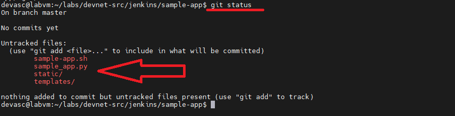

# TECHNICAL LOG & Build a CI/CD Pipeline Using Jenkins

## CI/CD
**CCNP Miguelangel Luna**
---

## CONTENIDOS:

| Case | Title | Description |
| :--- | :--- | :--- |
| **01** | [Claude & n8n AI Agents](./case-01-Google-Auth/) | Agentes Claude . |

[Cisco Networking Academy](https://www.google.com)

## 1. Introduction and Theoretical Framework

The Weight attribute is a Cisco proprietary parameter used in BGP (Border Gateway Protocol) for best path selection. Its main characteristics are:

* **Local Scope:** It has meaning exclusively within the local router where it is configured and is not propagated via BGP routing updates to neighbors.

## 2. Topology and BGP Neighbor Establishment

The topology consists of four routers across different Autonomous Systems (AS 100, AS 200, AS 300, and AS 400). Before advertising prefixes, BGP neighbor adjacencies were established on each device.


## 3. CI/CD Pipeline Configuration:

3.1 **Send the Sample Application to Git**

Replace **`"Sample User"`** with your real name and **`user@example.com`** with your email (use your GitHub credentials):

```text
git config --global user.name "Sample User"
git config --global user.email sample@example.com
```
3.2. **Initialize the directory as a Git repository:**

The application files are already pre-installed in the lab path. Navigate to them and initialize Git:

```text
cd labs/devnet-src/jenkins/sample-app/
git init
```

3.3. **Link the local repository to GitHub:**

- Go to GitHub and log in.
- Create a new repository named **`sample-app`**, with an optional description, and configured as **Private** (or **Public**, depending on your preference).
- Connect your local repository by running the following command in the terminal (replace `github-username` with your GitHub username, maintaining exact case sensitivity):

```text
git remote add origin https://github.com/github-username/sample-app.git
```

3.4. **Stage, commit, and push the files (git add, commit, and push):**

**Command git add (*):** Stages all files and directories in the current working directory.

```text
git add *
```

**Command git status:** Checks the current state of your working directory and staging area.  It shows you which files have been staged (ready to be committed), which ones are modified, and which ones are untracked. It's a great sanity check before saving your changes.

```text
git status
```


**Command git commit -m "Committing sample-app files.:**

```text
git commit -m "Committing sample-app files."
```

```text
git push origin master
```

Follow these steps in your virtual machine terminal:

#### 1. Configure your local Git credentials:
Replace `"Sample User"` with your real name and `user@example.com` with your email address (you can use your GitHub account details):

**Router A (RTA - AS 100):**


### 4. BGP Configuration:

