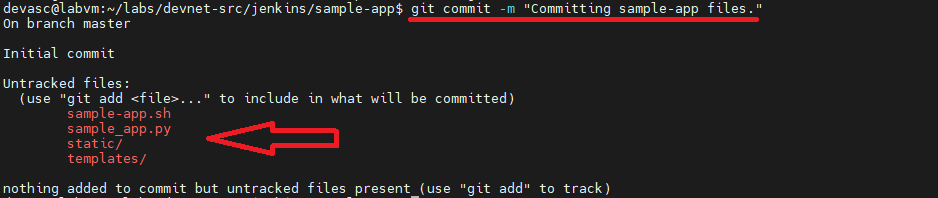
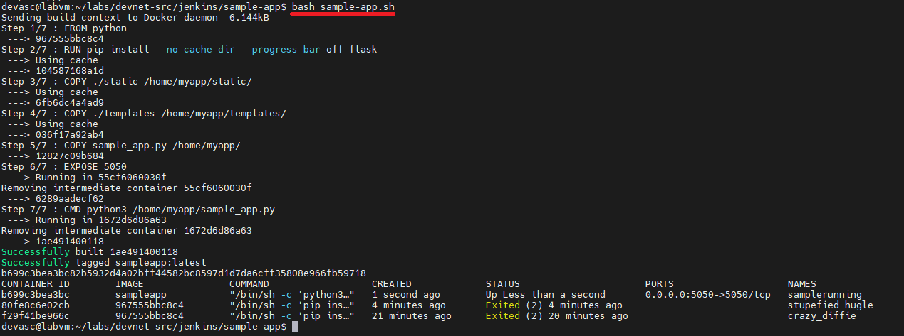
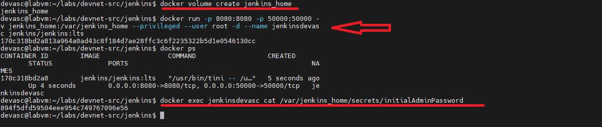

# TECHNICAL LOG & Build a CI/CD Pipeline Using Jenkins

## CI/CD
**CCNP Miguelangel Luna**
---

## CONTENIDOS:

| Case | Title | Description |
| :--- | :--- | :--- |
| **01** | [Claude & n8n AI Agents](./case-01-Google-Auth/) | Agentes Claude . |

[Cisco Networking Academy](https://www.google.com)

## 1. Introduction and Theoretical Framework

The Weight attribute is a Cisco proprietary parameter used in BGP (Border Gateway Protocol) for best path selection. Its main characteristics are:

* **Local Scope:** It has meaning exclusively within the local router where it is configured and is not propagated via BGP routing updates to neighbors.

## 2. Topology and BGP Neighbor Establishment

The topology consists of four routers across different Autonomous Systems (AS 100, AS 200, AS 300, and AS 400). Before advertising prefixes, BGP neighbor adjacencies were established on each device.

## 3. Build a CI/CD Pipeline Using Jenkins Configuration:

###  Commit the Sample App to Git Configuration:

3.1 **Send the Sample Application to Git**

Replace **`"Sample User"`** with your real name and **`user@example.com`** with your email (use your GitHub credentials):

```text
git config --global user.name "Sample User"
git config --global user.email sample@example.com
```
3.2. **Initialize the directory as a Git repository:**

The application files are already pre-installed in the lab path. Navigate to them and initialize Git:

```text
cd labs/devnet-src/jenkins/sample-app/
git init
```

3.3. **Link the local repository to GitHub:**

- Go to GitHub and log in.
- Create a new repository named **`sample-app`**, with an optional description, and configured as **Private** (or **Public**, depending on your preference).
- Connect your local repository by running the following command in the terminal (replace `github-username` with your GitHub username, maintaining exact case sensitivity):

```text
git remote add origin https://github.com/github-username/sample-app.git
```

3.4. **Stage, commit, and push the files (git add, commit, and push):**

**Command git add (*):** Stages all files and directories in the current working directory.

```text
git add *
```

**Command git status:** Checks the current state of your working directory and staging area.  It shows you which files have been staged (ready to be committed), which ones are modified, and which ones are untracked. It's a great sanity check before saving your changes.

```text
git status
```


**Command git commit -m "Committing sample-app files.:** Saves your staged changes permanently to your local repository history.   
**Explanation:**

**`commit:** Takes a snapshot of the staged files.   
**-m:** Stands for "message", allowing you to attach a short, descriptive note explaining what changes were made and why.

```text
git commit -m "Committing sample-app files."
```



```text
git remote add origin https://github.com/mlunadevops/sample-app.git
```

**Command git push origin master:**  Uploads your local commits to your remote repository on GitHub.  
**Explanation:**
**origin:** The default shorthand alias pointing to your remote repository URL on GitHub.
**master:** The name of the local branch you are pushing (uploading) to the remote server.
**(Remember that this is where you will provide your GitHub username and Personal Access Token instead of your password).**

```text
git push origin master
```

###  Modify the Sample App and Push Changes to Git:

3.5 **Send the Sample Application to Git**

Ensure you are in the correct working directory inside your VS Code terminal.

 ```text
cd ~/labs/devnet-src/jenkins/sample-app/
```

3.6 **Edit the Files**

1. In the **`sample_app.py`** file:
2. Find the last line and change the port from `8080` to `5050` so that it looks like this:

 ```text
#!/bin/bash

rm -rf tempdir
mkdir tempdir
mkdir tempdir/templates
mkdir tempdir/static

cp sample_app.py tempdir/.
cp -r templates/* tempdir/templates/.
cp -r static/* tempdir/static/.

echo "FROM python" > tempdir/Dockerfile
echo "RUN pip install --no-cache-dir --progress-bar off flask" >> tempdir/Dockerfile
echo "COPY ./static /home/myapp/static/" >> tempdir/Dockerfile
echo "COPY ./templates /home/myapp/templates/" >> tempdir/Dockerfile
echo "COPY sample_app.py /home/myapp/" >> tempdir/Dockerfile
echo "EXPOSE 5050" >> tempdir/Dockerfile
echo "CMD python3 /home/myapp/sample_app.py" >> tempdir/Dockerfile

cd tempdir
docker build -t sampleapp .
docker run -t -d -p 5050:5050 --name samplerunning sampleapp
docker ps -a
```
3.7 **Build and run your app:**

 ```text
bash sample-app.sh
```


3.8 **Stop the Test Container (samplerunning):**

As usual, free up the port and clean up the running container:

 ```text
docker stop samplerunning
docker rm samplerunning
```

3.9 **Make the Final Commit and Push for Part 3 to GitHub**

Return to the root directory of your application and push the final changes to your remote repository:

 ```text
cd ~/labs/devnet-src/jenkins/sample-app/
git add .
git status
git commit -m "Changed port from 8080 to 5050 and fixed pip build flags."
git push origin master
```

### Download and Run the Jenkins Docker Image

3.10 **Create the Working Directory for Jenkins (Exit the application directory and move to the main Jenkins folder on the VM):**

 ```text
cd ~/labs/devnet-src/jenkins/
```

```text
docker volume create jenkins_home
```

3.11 **Run the Jenkins Docker container with privileged root access:**

```text
docker run -p 8080:8080 -p 50000:50000 -v jenkins_home:/var/jenkins_home --privileged --user root -d --name jenkinsdevasc jenkins/jenkins:lts
```

3.12 **Get your initial administrator password:**

```text
docker exec jenkinsdevasc cat /var/jenkins_home/secrets/initialAdminPassword
```



